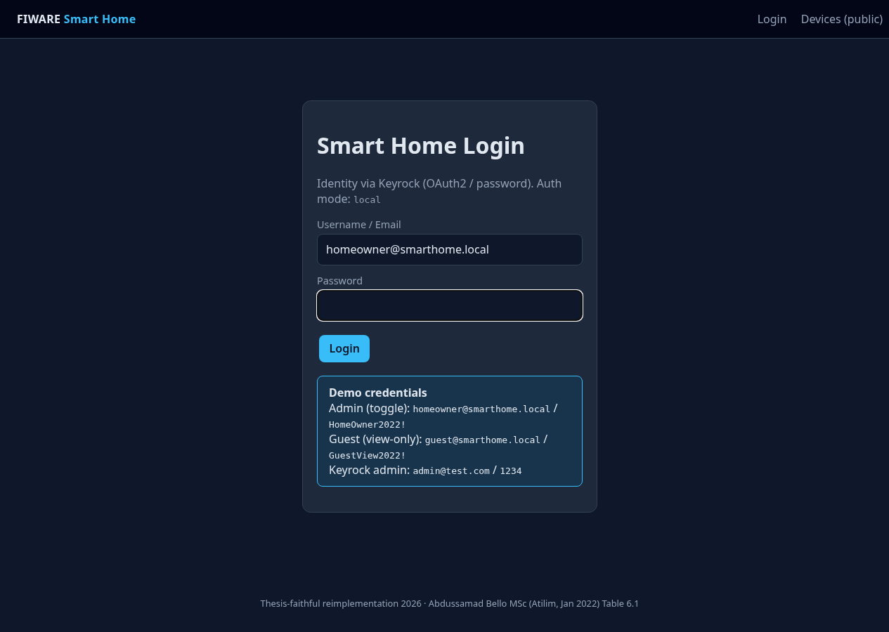
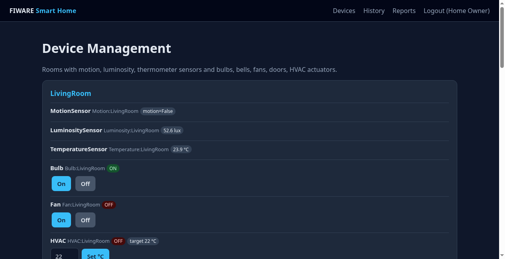
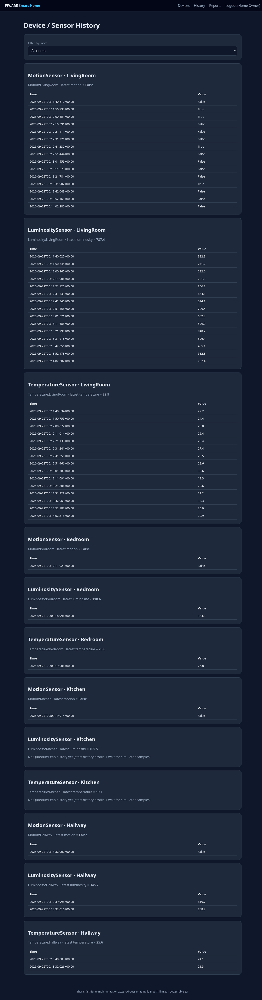

# FIWARE Smart Home Reference Architecture — PoC

[](./LICENSE)
[](https://www.fiware.org/)
[](#known-differences-from-2022-thesis)

Open-source **proof of concept** of an interoperable smart-home stack built on FIWARE Generic Enablers, mapped to the reference architecture in:

> **Abdussamad Bello** — *Design and Implementation of IoT-Based Reference Architecture for Smart Homes*  
> MSc thesis, Atilim University, January 2022  
> ORCID: [0000-0003-3278-9141](https://orcid.org/0000-0003-3278-9141)

This repository is a **2026 thesis-faithful reimplementation** for reproducibility and public demonstration. It is **not** a bit-for-bit copy of the original private PoC source. Component roles follow **Table 6.1** of the thesis; see **[THESIS_MAPPING.md](./THESIS_MAPPING.md)**.

**Suggested public repo names:** `fiware-smart-home-reference-architecture-poc` or shorter `fiware-smart-home-poc`.

---

## Architecture

Home + cloud layers (text diagram; Table 6.1 roles):

```
┌─────────────────────────────────────────────────────────────────┐
│  Smart Home Application (FastAPI + Jinja)                       │
│  login · rooms/devices · actuator commands · history · reports │
└───────────────┬───────────────────────────────┬─────────────────┘
                │ OAuth2 / password             │ NGSI-v2 query/cmd
                ▼                               ▼
         ┌─────────────┐                 ┌─────────────┐
         │  Keyrock    │◄──MySQL──┐      │   Orion     │◄──MongoDB
         │  (IdM)      │          │      │  Context    │
         └─────────────┘          │      └──────┬──────┘
                                  │             │ notify
┌─────────────────────────────────┼─────────────┼─────────────────┐
│  Data / history                 │             ▼                 │
│                                 │      ┌─────────────┐          │
│                                 │      │ QuantumLeap │──►CrateDB│
│                                 │      └─────────────┘ (+Redis) │
└─────────────────────────────────┼───────────────────────────────┘
                                  │
         ┌────────────────────────┴────────┐
         │  IoT Agent (JSON) — gateway     │
         └────────────────────────┬────────┘
                                  │ southbound HTTP JSON
                                  ▼
         ┌─────────────────────────────────┐
         │  Virtual Things (simulator)     │
         │  4 rooms · sensors + actuators  │
         └─────────────────────────────────┘
```

| Thesis role (Table 6.1) | Compose service |
|---|---|
| Devices / Virtual Things | `device-simulator` |
| IoT Gateway | `iot-agent` (JSON) |
| Context Information | `orion` + `mongo-db` |
| Device / Identity Mgmt | `keyrock` + `mysql-db` |
| Data Management | `quantumleap` + `crate-db` (+ `redis-db`) |
| Smart Home Application | `webapp` (FastAPI) |

---

## Screenshots (LOCAL DEMO)







---

## Quick start

Requires Docker / Docker Compose. Full stack: roughly **6–8 GiB free RAM** recommended (Crate heap defaults to `512m` for constrained hosts).

```bash
git clone <this-repo> fiware-smart-home-poc
cd fiware-smart-home-poc
cp .env.example .env   # demo defaults only — change secrets before any shared deploy

# Full stack
docker compose --profile full up -d --build

# Or incremental / low-RAM
docker compose up -d                              # mongo + orion + iot-agent
docker compose --profile app up -d --build
docker compose --profile idm up -d
docker compose --profile history up -d
```

Open **http://localhost:8080/login**.

Optional Keyrock OAuth app seed:

```bash
./scripts/provision_keyrock.sh
```

Smoke test:

```bash
./scripts/smoke_test.sh
```

Stop:

```bash
docker compose --profile full down
docker compose --profile full down -v   # also remove volumes
```

> **Note:** On some hosts Docker bridge ICC is broken; this compose file includes `extra_hosts: host-gateway` as a workaround. See `docs/SMOKE_TEST.md` for box-specific notes.

---

## Demo credentials — LOCAL DEMO ONLY

> **WARNING:** These accounts and passwords are for **local educational demos only**.  
> Do **not** reuse them on any public, shared, or production deployment.  
> Change `WEBAPP_SECRET_KEY`, OAuth secrets, and DB passwords in `.env` before exposing the stack.

| User | Password | Privileges |
|---|---|---|
| `homeowner@smarthome.local` | `HomeOwner2022!` | View + toggle actuators |
| `guest@smarthome.local` | `GuestView2022!` | View only |
| `admin@test.com` | `1234` | Keyrock default admin |

`AUTH_MODE` in `.env`:

- `local` — demo users above (reliable for smoke tests)
- `keyrock` — try Keyrock first, then fall back to local users

---

## Happy-path demo

1. **Login** at `/login` as homeowner.
2. **See rooms** on `/devices` (LivingRoom, Bedroom, Kitchen, Hallway).
3. **Toggle** Bulb / Fan / Door / Bell / HVAC (authorized).
4. Open `/devices/public` (logged out) → toggle blocked with auth error.
5. Login as **guest** → devices visible, toggle blocked.
6. **History** `/history` and **charts** `/reports` (needs `history` profile + a few simulator ticks).

Smoke verification on a 2026 box run (see `docs/SMOKE_TEST.md`): **27** Orion entities, actuator commands accepted for homeowner / denied for guest, QuantumLeap history for motion samples, `smoke_test.sh` failures=0.

---

## Ports

| Service | Host port |
|---|---|
| Web app | 8080 |
| Orion | 1026 |
| IoT Agent north / south | 4041 / 7896 |
| Keyrock | 3005 |
| QuantumLeap | 8668 |
| CrateDB HTTP | 4200 |
| MongoDB | 27017 |
| MySQL | 3306 |
| Redis | 6379 |

---

## Compose profiles

| Profile | Services |
|---|---|
| *(always-on)* | `mongo-db`, `orion`, `iot-agent` |
| `idm` | `mysql-db`, `keyrock` |
| `history` | `redis-db`, `crate-db`, `quantumleap` |
| `app` | `webapp`, `device-simulator` |
| `full` | idm + history + app (plus always-on core) |

---

## Mapping to the thesis

| Topic | Where |
|---|---|
| Table 6.1 component → path | [THESIS_MAPPING.md](./THESIS_MAPPING.md) |
| Functional requirements (rooms, sensors, actuators, roles) | same file |
| Citation metadata | [CITATION.cff](./CITATION.cff) |
| Short paper draft (preprint / workshop) | [paper/paper-draft.md](./paper/paper-draft.md) |

---

## Known differences from 2022 thesis

| Topic | Difference |
|---|---|
| Source code | Reimplementation — original private PoC not published |
| Image versions | Modern FIWARE images (Orion 3.x, IoTA-JSON 2.x, Keyrock 8.x, QuantumLeap 1.x) |
| Devices | Virtual-only (HTTP JSON simulator); no physical hardware |
| IoT Agent | JSON agent (same FIWARE gateway role as Ultralight in the thesis era) |
| PEP / Wilma | AuthZ enforced in the web app; Wilma not required for this PoC |
| UI stack | FastAPI + Jinja |
| Auth fallback | Local demo users if Keyrock OAuth app not provisioned |
| CrateDB RAM | Heap lowered (`CRATE_HEAP_SIZE=512m`) for constrained hosts |
| Docker networking | `extra_hosts: host-gateway` workaround when bridge ICC is broken |

---

## Repository layout

```
fiware-smart-home-poc/
  docker-compose.yml
  .env.example          # commit this; never commit .env
  LICENSE               # MIT, Copyright (c) 2022-2026 Abdussamad Bello
  CITATION.cff
  THESIS_MAPPING.md
  README.md
  app/                  # Smart Home web application
  scripts/              # Device provision + simulator + smoke tests
  docs/
    SMOKE_TEST.md
    screenshots/        # UI captures for README
  paper/
    paper-draft.md
    COVER_NOTE.md
```

---

## Citation

Please cite the original thesis when referring to the reference architecture, and this repository when referring to the open 2026 PoC:

```
Bello, A. (2022). Design and Implementation of IoT-Based Reference Architecture
for Smart Homes (MSc thesis). Atilim University.

Bello, A. (2026). FIWARE Smart Home Reference Architecture — Proof of Concept
(software). https://orcid.org/0000-0003-3278-9141
```

See `CITATION.cff` for machine-readable metadata.

---

## License / attribution

- **This wiring and application code:** [MIT](./LICENSE) — Copyright (c) 2022–2026 Abdussamad Bello.
- **FIWARE Generic Enablers and other images:** remain under their upstream licenses.
